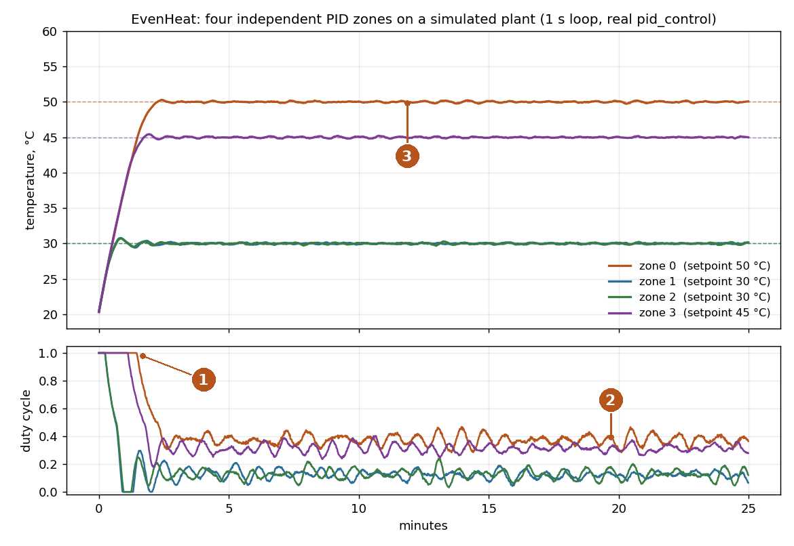
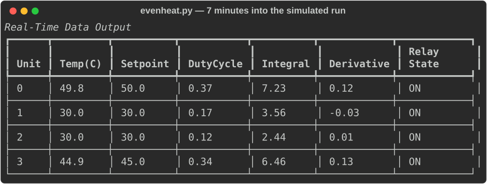

# EvenHeat: four-zone PID heating with Phidgets

*Public summary, 2026-11-01. The working repository is private; the excerpts below are the parts worth showing.*

## The problem I wanted to solve

A heated enclosure with one heater and one thermostat gives you a hot spot and cold corners. I wanted an even temperature field across a volume, so the controller drives **four heating elements, each with its own temperature sensor and its own PID loop**. The configuration places the elements in space (one above the centre, three in a triangle lower down) and gives each zone its own setpoint, so the geometry can be compensated rather than averaged away.

## Demonstration

No Phidget hardware is attached to the machine I ran this on, so the demonstration runs the **real `pid_control()` function** (extracted from the script by AST, not retyped) against a simulated first-order thermal plant per zone, with the real `config.json` gains and setpoints and the real one-second loop.



1. Every zone starts saturated at 100 % duty, because a 30 °C error times Kp = 0.1 is already past the 0–1 output clamp.
2. Once the error is small the integral term carries the steady-state duty (about 0.37 for the 50 °C zone), which is why the anti-windup clamp of ±10 matters: it bounds how far the integral can run during the saturated warm-up.
3. All four zones settle within ±0.2 °C of their setpoints and stay there.

What the operator sees is the terminal table the script redraws every second:



## Architecture and my contribution

```
config.json (presets: elements, sensors, per-zone PID gains, geometry)
   └─ evenheat.py
        ├─ Phidget22 VINT hub, port 0: 4 × DigitalOutput (heaters, PWM duty cycle)
        ├─ Phidget22 VINT hub, port 5: 4 × TemperatureSensor
        ├─ 1 s loop: read 4 temperatures → 4 × PID → 4 duty cycles
        └─ rich table on the terminal
```

- **Mine:** the whole controller and its configuration (one Python script and one JSON file, written in PyCharm in late 2024).
- **Agent assistance:** none in the control logic. In October 2026 a Claude Code session reviewed the code, packaged it as a git repository with a sensible `.gitignore`, and wrote the documentation; in November 2026 it produced this summary and the simulation above.

## What works today, what remains experimental

| Works | Experimental or missing |
|---|---|
| Per-zone PID with anti-windup, output as PWM duty cycle | The spatial model: element positions, `heatmap_bounds` and `temperature_scale` are in the config but nothing renders a heat map yet |
| Preset selection from the command line | Data logging is defined but never called, so the gains have not been tuned on recorded runs |
| Live terminal table with temperature, setpoint, duty, integral and derivative per zone | No safety layer independent of the script (over-temperature cutoff, sensor-fault handling, watchdog) |
| Clean shutdown closes every Phidget channel | The loop assumes exactly 1 s per iteration; the derivative acts on raw error and kicks on setpoint changes |

## Representative code

The control step is deliberately small. The two clamps are the design: the integral is bounded so a long saturated warm-up cannot wind it up, and the output is bounded to what a duty cycle can express. Everything else (which zone, which gains, which setpoint) comes from the config, so the loop body never changes when the enclosure does.

```python
# PID control function with anti-windup
def pid_control(setpoint, current_temp, prev_error, integral, Kp, Ki, Kd):
    error = setpoint - current_temp
    integral += error
    integral = max(-10.0, min(10.0, integral))  # Anti-windup
    derivative = error - prev_error
    output = max(0, min(1, Kp * error + Ki * integral + Kd * derivative))
    return output, error, integral

# ... inside the 1 s loop: one independent controller per configured unit
for unit in config["units"]:
    idx = unit["index"]
    setpoint = unit["setpoint"]
    Kp, Ki, Kd = unit["Kp"], unit["Ki"], unit["Kd"]
    duty_cycle, prev_errors[idx], integrals[idx] = pid_control(
        setpoint, current_temps[idx], prev_errors[idx], integrals[idx], Kp, Ki, Kd
    )
    heating_elements_by_index[idx].setDutyCycle(duty_cycle)
```

The next engineering step is obvious from the simulation: add `dt` to the loop and a derivative on measurement rather than on error, then tune against a recorded run of the real enclosure.
